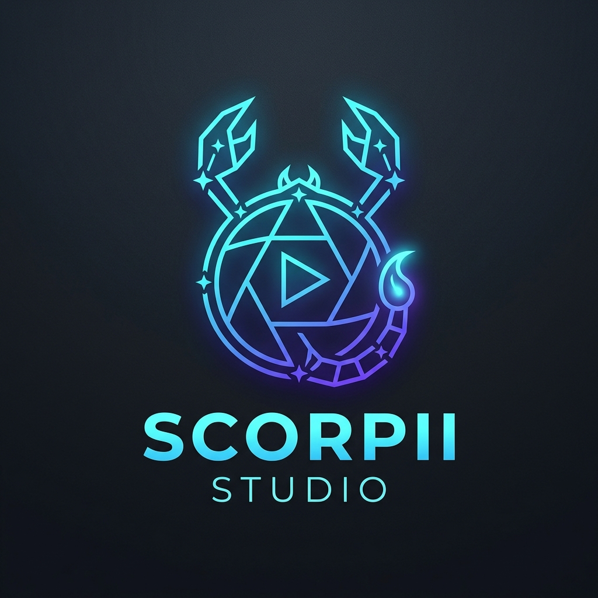

<div align="center">



# SCORPII STUDIO
### *CREATE WITHOUT LIMITS.*

[](https://github.com/ScoRpiiTech/Scorpii-Studio)
[](https://www.rust-lang.org/)
[](https://wgpu.rs/)
[](PRODUCT_BRIEF.md)
[](LICENSE)

<p align="center">
  <b>A next-generation, local-first desktop video creation suite engineered for creators, speed, and privacy.</b><br>
  No watermarks. No subscriptions. No cloud locks. Your media stays on your disk.
</p>

</div>

---

## ✨ Highlights & Creator Features

* ⚡ **1-Click 9:16 Shorts/Reels Fast-Cut**: Instant aspect-ratio switching between horizontal ($16:9$) and vertical ($9:16$ Shorts, Reels, TikTok) with smart centering and GPU preview.
* 🔒 **100% Local-First & Private**: Everything runs entirely on your local hardware. No footage is ever uploaded to external servers.
* 💬 **Local AI Auto-Captions**: In-process Whisper speech-to-text. Pick your model size and generate synchronized, styled captions right on the timeline.
* 🗣️ **Local AI Voiceover & TTS**: Fast, offline voice generation and voice cloning powered by Kokoro and sherpa-onnx.
* 🦀 **Native Rust Performance**: Custom multi-track timeline, low-latency audio mixing, and high-performance frame scheduling with zero garbage collection pauses.
* 🎮 **GPU Compositor**: Smooth 60fps scrubbing with 170+ built-in WGSL shader transitions, color grading LUTs, and animated keyframes.
* 📤 **Studio Export**: Fast hardware-accelerated encoding up to 4K 60fps in H.264, HEVC, and AV1.
* 🤖 **Automation & Agent Ready**: Built-in CLI (`concat-cli`), Model Context Protocol (MCP), and JSON-RPC / gRPC interfaces to automate edits programmatically.

---

## 🚀 Quick Start (Windows)

### 1. Launch Immediately
If you already have the repository built, simply double-click the launcher:
```bat
run_studio.bat
```
*(Or navigate to `src/` and run `cargo run -p concat`)*

### 2. Building from Source
Ensure you have the required prerequisites:
* **Rust**: 1.93.1 pinned toolchain (`rustup toolchain install 1.93.1`)
* **C++ Compiler**: Visual Studio 2022 C++ Build Tools
* **CMake & LLVM**: Available in system `PATH`
* **FFmpeg 8.1 & ONNX Runtime 1.28.0**: Unpacked in `vendor/` (see [ARCHITECTURE_DECISIONS.md](ARCHITECTURE_DECISIONS.md))

Run the editor in development mode:
```pwsh
cd src
cargo run -p concat
```

Run automated verification:
```pwsh
cd src
cargo test --all
```

---

## 🛠️ Automation CLI

Scorpii Studio includes a dedicated CLI binary to drive media processing headlessly:

```pwsh
# Probe media metadata
cargo run -p concat-cli -- probe video.mp4

# Quick render / re-encode
cargo run -p concat-cli -- render input.mp4 output.mp4 --frames 120

# Start JSON-RPC API server
cargo run -p concat-cli -- serve --port 7420
```

---

## 🏛️ Project Governance & Architecture

* **[PRODUCT_BRIEF.md](PRODUCT_BRIEF.md)** — Product roadmap, creator use cases, and MVP milestones.
* **[AGENTS.md](AGENTS.md)** — Core engineering directives, git invariants, and integration rules.
* **[ARCHITECTURE_DECISIONS.md](ARCHITECTURE_DECISIONS.md)** — Architectural decision records (ADRs) and dependency topology.
* **[UPSTREAM_PATCHES.md](UPSTREAM_PATCHES.md)** — Ledger of all local modifications to maintain clean upstream sync.
* **[TEST_PLAN.md](TEST_PLAN.md)** — Comprehensive quality gates and media integrity validation.

---

## ⚖️ License & Attribution

Scorpii Studio builds upon the foundation of [Concat](https://github.com/jub0t/Concat) and is licensed under the **GNU Affero General Public License v3.0 or later** ([AGPL-3.0-or-later](LICENSE)) with the plugin exception ([LICENSE-EXCEPTIONS.md](LICENSE-EXCEPTIONS.md)). 

Third-party component notices and licenses are documented in [THIRD_PARTY_NOTICES.md](THIRD_PARTY_NOTICES.md) and [LICENSE_INVENTORY.md](LICENSE_INVENTORY.md).
